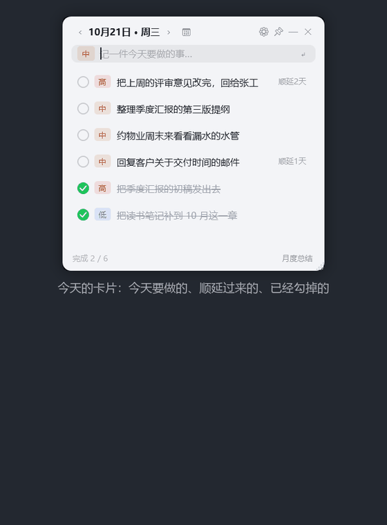

# Memo

> 常驻桌面的今日待办小卡片。只记「今天要做的事」，也能提前把明天、下周的安排写好；每次开机它就待在屏幕角上，随时瞄一眼、随手加一条。

[](https://github.com/xiayijieXYJ/memo-desktop/actions/workflows/build.yml)
[](LICENSE)


<p align="center">
  
</p>

<p align="center"><sub>卡片 → 勾掉一条自动划线沉底 → 月度总结按月回看</sub></p>

<p align="center">
  
  &nbsp;&nbsp;
  
</p>

<p align="center"><sub>左：今日卡片（浅色主题）　右：月度总结 —— 本月完成了什么、还在处理哪些</sub></p>

<p align="center"><a href="https://xiayijieXYJ.github.io/memo-desktop/">→ 产品主页（截图、下载、常见问题）</a></p>

## 功能

- **桌面常驻**：无边框圆角卡片，可拖动到任意位置，位置和尺寸下次启动自动恢复。设置窗和日历小窗同样可以按住空白处拖走（按钮、滑块、日期格子照常点击，不会误触发拖动）
- **始终置顶**：默认压在其他窗口上面，点 📌 可切换
- **今天的待办**：顶部一行是「‹ 10月20日 · 周二 › 📅」加右侧 ⚙📌—✕，剩余数量看底部状态栏的「完成 2 / 9」；窗口最窄 280（再窄日期会被省略）。左右箭头固定在日期两侧，窗口拉宽时不会跟着飘到右边
- **三档优先级**：高 / 中 / 低，点击条目上的徽章即可轮转切换，列表自动按优先级排序
- **昨天没做完的自动顺延**：未完成的条目第二天继续出现，并标注「顺延 N 天」
- **按日期回看历史**：点标题旁 `‹ ›` 按自然日翻前一天/后一天（空白日子显示「这天没有记录」），或点 📅 开日历（有记录的日子带蓝点）直接挑；看过去时整卡只读，点「回到今天」复原
- **提前给将来安排**：往后翻（`›` 或日历里点将来的某天）就切到「安排 10月21日」，输入框提示变成「提前记下 10月21日 要做的事…」，加进去的事记在那一天，**不会提前冒到今天**；将来那天和今天一样能加、能勾、能改优先级，翻到日子到了自然出现在今天的列表里（昨天没做完的照样顺延）
- **勾选完成**：打勾后划线并移到底部，右键菜单「清除已完成」一次性清掉；**今天才勾掉的旧条目当天仍留在卡片上**（比如 20 日记下、21 日才办完的），第二天才退出，不会"一勾就凭空消失"
- **月度总结**：底部「月度总结」按钮（或卡片空白处右键「月度总结…」）打开小窗，`‹ ›` 翻月份、「回到本月」跳回当月。上半截是**本月完成**的清单，按 `done_date` 记账——9 月安排、10 月才勾掉的事算 10 月的成绩；下半截**仍在处理**是全部没做完的条目，不分月份，过期的标「顺延 N 天」；顶部三个数字分别是本月完成 / 本月新增 / 仍在处理
- **双击复制**：月度总结里双击任意一行，把那条原文复制走（只读窗，双击本来就是空着的），标题行右侧会闪一下「已复制」；主卡片双击仍是进编辑，要复制走条目右键「复制文字」
- **删除可撤销**：删除只打标记不真删，底部「撤销」按钮可以把最近删除的条目还原回来
- **删除入口只有右键菜单**：条目上不再有悬停出现的 ✕ 按钮，避免置顶窗口吃掉下方窗口的点击
- **条目排版**：勾选框与优先级徽章顶部对齐、两者留 6px 间隔，多行长文案的行距固定 20px
- **快速录入**：在输入框敲回车即可添加，Esc 清空
- **双击编辑**：双击条目的文字直接改，回车保存、Esc 取消。编辑框宽度就是列表列宽，长文案会自动换行、框随内容长高（从第一行就能看到全文，不用横向拖到末尾），窗口本身尺寸不变，超出卡片的部分交给外层滚动
- **托盘常驻，任务栏无图标**：点 — 或 ✕ 都收进托盘；托盘图标左键单击唤出/收起
- **全局热键**：`Ctrl + Alt + M` 无论当前在哪个程序都能唤出卡片
- **深色 / 浅色 / 浅黄三套主题**：设置里点主题胶囊三选一；选择存进 `settings.json`，重开还是那个主题（首次启动是深色）。主卡片、设置窗、日历小窗、右键菜单、复选框、滑块全都跟着变
- **设置**：主题、不透明度、置顶开关、显示/隐藏已完成、开机自启
- **右键菜单**：卡片空白处右键可打开设置 / 添加一条 / 清除已完成 / 显示或隐藏已完成 / 隐藏到托盘；条目上右键可编辑、复制文字、改优先级、删除
- **数据本地存储**：SQLite 文件，不上传任何地方

## 环境要求

- Windows 10 1809+ / Windows 11
- [.NET 8 桌面运行时](https://dotnet.microsoft.com/download/dotnet/8.0)（Desktop Runtime）——仅框架依赖版需要；自包含版不用装
- 从源码构建需要 .NET 8 SDK

## 下载即用

到 [Releases](../../releases) 下载 `Memo.exe`（单文件、框架依赖），放到一个固定目录双击即可，
不写注册表、不装服务。第一次运行 Windows 可能弹「已保护你的电脑」，点「更多信息 → 仍要运行」
（单文件没有代码签名证书，属于正常现象）。

想给没装 .NET 的机器用，就跑 `publish-standalone.cmd` 打成自包含版（约 64MB）。

## 从源码构建

```bash
git clone https://github.com/xiayijieXYJ/memo-desktop.git
cd Memo
dotnet build Memo.csproj -c Release
```

也可以用 Visual Studio 2022 打开 `Memo.csproj` 直接 F5。

改完代码要重新发布一次，`publish\Memo.exe` 的时间戳更新了才算生效：

```
dotnet publish -c Release -r win-x64 --self-contained false -p:PublishSingleFile=true -p:IncludeNativeLibrariesForSelfExtract=true -o publish
```

（等价于跑 `publish.cmd`。）

首次想看看效果，可以塞几条演示数据：

```
Memo.exe --seed
```

## 打包成单文件

两种打法等价，选一个就行：

- `publish.cmd` —— **框架依赖**版，产物 `publish\Memo.exe` 约 2.4MB。目标机必须装 .NET 8 桌面运行时。
- `publish-standalone.cmd` —— **自包含**版，产物 `dist\Memo-portable\Memo.exe` 约 64MB。目标机什么都不用装，双击即用。

发给别人用自包含版；自己机器用框架依赖版更省空间。

> `.cmd` 脚本必须存成 **GBK + CRLF**：cmd.exe 按 GBK 读脚本，用 UTF-8 存中文会被拆坏成
> `'e' is not recognized as an internal or external command`，而且报错后脚本会继续往下跑、退出码仍可能是 0，容易误判发布成功。
> 发布后请检查产物的时间戳确实更新了。

## 快捷键

| 操作 | 快捷键 |
| --- | --- |
| 唤出 / 收起卡片 | `Ctrl + Alt + M` |
| 添加条目 | 输入框内 `Enter` |
| 清空输入框 | `Esc` |
| 编辑条目 | 双击文字，`Enter` 保存 / `Esc` 取消 |
| 复制条目文字 | 月度总结里双击那一行；主卡片用右键「复制文字」 |

## 数据位置

- 数据库：`%APPDATA%\Memo\memo.db`
- 自动备份：`%APPDATA%\Memo\backups\`（每次启动做一份快照，保留最近 20 份）
- 界面设置：`%APPDATA%\Memo\settings.json`
- 删除审计：`%APPDATA%\Memo\delete-audit.log`

备份用的是 SQLite 的 `VACUUM INTO`，拿到的一定是一致性快照，可以直接改名成 `memo.db` 顶回去。
空库不备份，所以「有内容」的快照不会被空快照挤掉。

删除是软删除：库里只写 `deleted_at` 时间戳，行不会真的消失，所以底部「撤销」能把最近删掉的条目捞回来。

> 为什么删除入口只留右键菜单：卡片是**始终置顶**窗口，会压在别的窗口上面。以前每行末尾有个悬停才显示的 ✕ 按钮，
> 那个按钮即使 `Opacity=0` 仍然参与命中测试——鼠标快速划过行尾那一格并按下时，点击会被它吃掉并直接删条目；
> 删掉一行下面的行上移，同一坐标再点又删一条，实测连续误删过 4 条数据。
> 现在删掉整行右端的按钮，只保留右键菜单「删除」，并配合软删除 + 撤销兜底。

删除动作会记审计日志 `%APPDATA%\Memo\delete-audit.log`（含时间、进程、调用栈），
用来回答「这条到底是谁删的」。日志只在正式库写，`--selftest` 不写。

真要彻底清空，直接删 `memo.db` 重来即可（删前先把 `backups` 里的快照留一份）。

设置窗口里有「打开数据目录」按钮可直接跳转。

## 项目结构

```
Memo/
├── App.xaml(.cs)              应用入口、单实例、托盘与热键装配
├── MainWindow.xaml(.cs)       卡片主界面
├── DatePickerWindow.xaml(.cs) 按日期回看 / 提前安排的日历小窗
├── MonthSummaryWindow.xaml(.cs) 月度总结小窗（本月完成 + 仍在处理）
├── SettingsWindow.xaml(.cs)   设置窗口
├── GlobalHotKey.cs            全局热键（RegisterHotKey）
├── TrayIconManager.cs         托盘图标与菜单（优先用 Assets/app.ico）
├── Converters.cs              XAML 值转换器
├── SelfTest.cs                --selftest 端到端自检
├── Themes/
│   ├── Dark.xaml              深色主题（画刷字典）
│   ├── Light.xaml             浅色主题（key 与 Dark 成对）
│   └── Sepia.xaml             浅黄色纸感主题（key 同上）
├── Models/
│   ├── MemoItem.cs            待办实体
│   └── SummaryEntry.cs        月度总结的一行（只读快照）
├── Services/
│   ├── MemoStore.cs           SQLite 存储层
│   ├── AppSettings.cs         界面设置持久化
│   ├── ThemeManager.cs        主题套用与切换
│   ├── ClipboardHelper.cs     剪贴板写入（被占用时返回失败而不是抛）
│   └── StartupRegistrar.cs    开机自启（注册表 HKCU\...\Run）
├── ViewModels/MemoViewModel.cs 列表、排序、优先级等业务逻辑
├── Assets/app.ico             程序与托盘图标
├── docs/
│   ├── screenshot.png         主卡片截图
│   ├── screenshot-summary.png 月度总结截图
│   └── 使用说明.txt            面向普通用户的操作说明（可直接随 exe 一起发）
└── .github/workflows/build.yml CI：Windows 上构建 + 打单文件包
```

## 技术选型说明

选 **WPF + .NET 8** 而不是 Electron / Tauri：

- 只依赖 Windows 自带的 WPF，框架依赖版装个 .NET 8 桌面运行时就能跑；Electron 要多带一份 Chromium（100MB+），Tauri 要装 Rust 工具链（约 1GB）
- 无边框透明窗口、圆角阴影、始终置顶是 WPF 的原生能力，几行 XAML 就够
- 内存占用小，作为常驻桌面工具比基于浏览器的方案轻得多
- 不依赖第三方 UI 库，纯系统控件 + 自定义模板，便于长期维护

数据层用 `Microsoft.Data.Sqlite`（微软官方维护），视图层用 `CommunityToolkit.Mvvm` 的源生成器，避免手写重复的 `INotifyPropertyChanged`。

### 主题是怎么做的

`Themes/Dark.xaml`、`Themes/Light.xaml`、`Themes/Sepia.xaml` 是三个 **key 完全一致**（各 44 个）的画刷字典，
`ThemeManager.Apply()` 只是把 `Application.Current.Resources.MergedDictionaries[0]` 整个换掉。所以界面里所有颜色都必须写成
`{DynamicResource Xxx}` —— `StaticResource` 只在加载时查一次，换了字典不会重新求值，切主题就会留下半张旧配色。
三个文件要**成对维护**：新增 key 时每个都得加，否则切到缺 key 的那套会直接抛 `ResourceReferenceKeyNotFoundException`。

主题在 `new MainWindow()` 之前套上，否则第一帧会先闪一下深色。复选框和滑块在 `App.xaml` 里重写了模板
（默认 WPF 模板是系统白底黑框 / 系统蓝，和卡片配色冲突）。

浅黄色那套不是把浅色染黄了事：底色用暖米黄 `#F8F5E8`，文字用暖褐 `#3B3226` 而不是纯黑（纯黑压在黄底上会发脏），
主按钮换成暖金棕 `#A1742A`，免得蓝色按钮在暖色卡片里太跳。

## 开发自检

```
Memo.exe --selftest
```

会把 95 项端到端断言（增删改查、软删除与撤销、优先级排序、跨天顺延、完成状态、空白输入校验、
按日期回看与只读约束、提前安排到将来、相邻日期导航、箭头可用状态、标题日期与星期拼接、
月度总结的完成/新增/未完成三个口径与跨月隔离）的结果写到
`%TEMP%\memo_selftest_result.txt`。它使用临时数据库，不会碰到真实数据。

`Memo.exe --seed` 会写入几条演示数据，方便第一次看效果。

## 给使用者的说明

`docs/使用说明.txt` 是一份面向非开发同事的纯文本说明（怎么加条目、怎么看以前的记录、数据存在哪、
怎么卸载），打包时会被 `publish-standalone.cmd` 一起拷进 `dist\Memo-portable\`，可以直接连 exe 发给别人。

## 许可

[MIT](LICENSE) © 2026 Memo contributors
